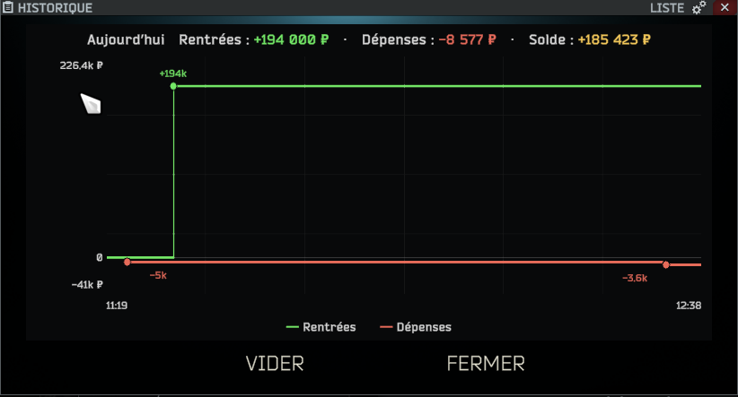
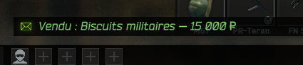
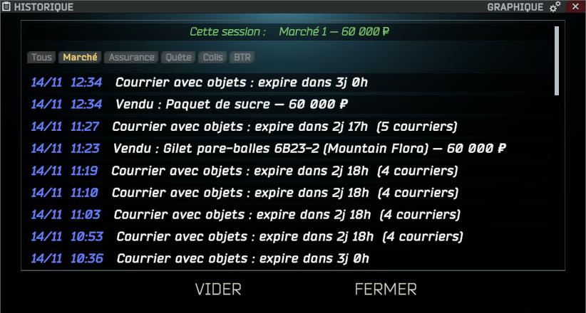
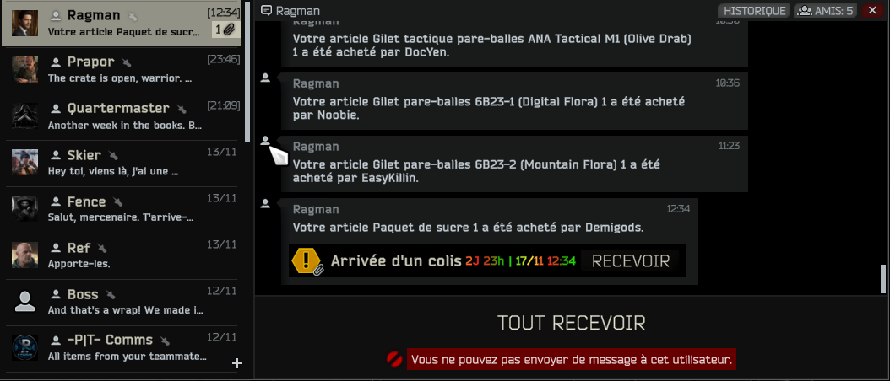
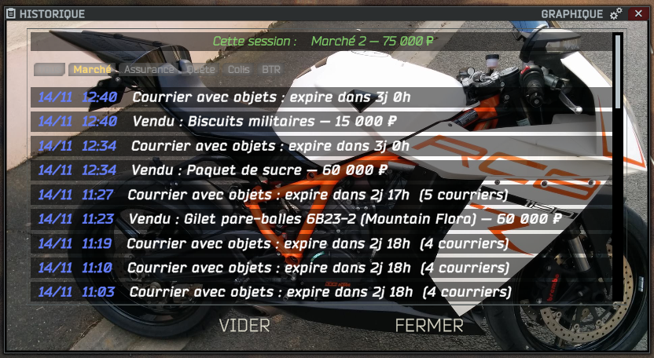
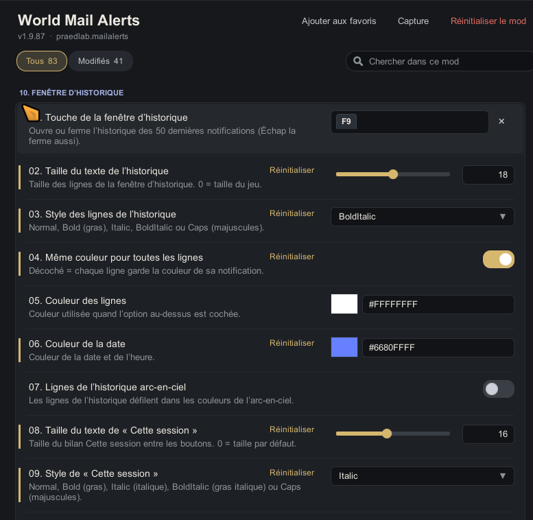

# 📬 World Mail Alerts 2.0.3

**Never lose a mail with items again, and keep track of everything your mail brings in.** A BepInEx plugin for SPT 4.1.x that warns you with a sound and the game's own notification when a mail with items is about to expire, shows your flea market sales with their price, and adds a **history window** with a **daily money graph**, built from the game's own interface. Menu and notifications in 16 languages.

  



## ✨ What you get

### 🔔 Alerts
- **Alerts from the moment you log in**: no need to open the messenger, the mod loads the trader mails with items by itself.
- **One notification per trader**, the most urgent first: `Prapor : mail to collect before 3d 4h (5 mails)`.
- **Mail type shown in the notification**: `[Insurance]`, `[Quest]`, `[Flea market]`, `[Parcel]`, `[BTR]`.
- **Flea market sales**: `[Flea market] Sold: Military biscuits ×2 — 13 000 ₽`, in place of the game's "Your offer was sold" message.
- **Modded traders** are shown with their real name.
- **4 alert levels** (by default 1 day, 6 h, 1 h, 10 min), each with its own delay, sound, color and repeat.
- **The game's own notification**, placed **anywhere on screen** with sliders or by dragging it, with a live preview. A stack of notifications always stays fully on screen, above the game's menu bar.
- **19 message formats**, 17 text styles, text size, letter spacing, 15 icons, short or long display.
- **226 built-in sounds** + your own `.wav` files (`BepInEx/config/WorldMailAlerts_sounds`).
- **Silent in raid**: the missed alert is replayed when you are back in the menu.



### 📜 History window (new in 2.0.0)
- Open it with **F9** or the **HISTORY** button in the messenger, next to FRIENDS.
- Made from the game's own window: same frame, fonts and buttons.
- **Move it and resize it** like a Windows window. Its position and size are saved.
- Every alert and sale with its **full date and time** (last 50 kept).
- **"This session" summary** at the top: sales and total, then each mail type.
- **Filters** made from the game's buttons: **All · Flea market · Insurance · Quest · Parcel · BTR**. The chosen filter is kept.
- **Settings gear** in the title bar (the game's own icon) opens the mod settings.





### 📈 Daily money graph (new in 2.0.0)
Click **CHART** in the history window title bar.
- 🟢 **Money in**: all the money that enters your stash today (flea market money once collected, trader sales including modded traders, quest rewards).
- 🔴 **Spent**: all the money that leaves your stash (purchases, insurance, repairs…).
- **A dot with the amount** on each money in (`+194k`, above the line) and each spending (`-5k`, below the line).
- Summary at the top: **Money in · Spent · Balance** for the day.
- Counts **₽, $, € and GP coins** in your stash and on your character, converted to roubles. Optional gold curve: your total money over the selected period (setting "Show the money curve").
- **Today / 7 days / 30 days** buttons. 31 days of data are kept, then deleted automatically.

### 🎨 Make it yours (F12 → History window)
- Window background color and opacity.
- **Background images**: 40+ backgrounds taken from the game, or your own images (`BepInEx/config/WorldMailAlerts_backgrounds`, `.png` / `.jpg`).
  - Fill / Fit / Stretch / Center, zoom, offsets, tint, opacity.
  - **Movement**: slow drift, horizontal or vertical pan, zoom pulse, diagonal, circle, breathing, shake, with a speed setting.
  - Recommended size: 1920×1080 or more. 3440×1440 for ultra-wide screens. Very large images are scaled down to 2560 px automatically.
- Lines: 9 formats (date, time, "ago"…), size, style, color, date color, dark background, **rainbow**.
- Summary: size, style, color.





## 🌍 Languages
English, Français, Русский, Deutsch, Español, 中文, 日本語, 한국어, Polski, Português, Čeština, Türkçe, Italiano, Magyar, Română, Slovenčina.

Setting `00. Language`: **Auto** uses your system language (English is the fallback). Restart the game after changing it. Settings are reset when the language changes.

> Everything is translated, including the setting tooltips in F12. Translations are machine-style and may contain mistakes: corrections are welcome.

## 📦 Compatibility
- SPT 4.1.x (BepInEx 5)
- **Standalone**: no other mod required. Works great alongside [World Mail Countdown](https://sp-mod.com/mod/3310/world-mail-countdown-add-16-translations) (live countdown on every package).
- Optional: **Configuration Manager** (F12) for the settings gear.

## 🔧 Installation
1. Copy the `BepInEx` folder into your SPT folder.
2. Optional: install [World Mail Countdown](https://sp-mod.com/mod/3310/world-mail-countdown-add-16-translations) for a live countdown on every package.

```
BepInEx/plugins/WorldMailAlerts.dll      (this mod)
BepInEx/config/WorldMailAlerts_backgrounds/   (put your own images here)
```

Settings: press **F12** in game → **World Mail Alerts**.

Updating from 1.x: replace `WorldMailAlerts.dll`. Your settings are kept.

## 📝 Changelog
### 2.0.3
- 📈 **Money graph: Today / 7 days / 30 days** buttons. In 7 and 30 days, one marker per day with that day's total. 31 days of data kept.
- 📈 **More accurate numbers**: money carried on your character now counts too (moving cash between stash and backpack is no longer counted as money in / spent), and gaps between game sessions are ignored.
- 📈 **More readable graph**: thicker lines, bigger bold numbers with an outline, only the meaningful amounts shown, gold balance line always drawn on top.
- 🪟 **"Clear" no longer shrinks the window**: the window and the graph keep their size.
- 🔘 **Filters more visible** (bigger, bold, active filter in gold).
- 🔊 **Custom .wav sounds no longer go silent after a raid** (the sound is reloaded if the game emptied it).

### 2.0.1
- **No longer requires World Mail Countdown**: World Mail Alerts now works on its own. Both mods still work together.

### 2.0.0
- **History window** (F9 or HISTORY button in the messenger): game-style window, movable and resizable, full timestamps, "This session" summary, filters, settings gear.
- **Daily money graph**: money in (green) and spent (red), a dot with the amount on each one, Money in / Spent / Balance summary. Counts ₽, $, € and GP. Optional gold curve.
- **Background images** for the window: game backgrounds or your own images, with fit modes, zoom, offsets, tint and 8 movement modes.
- Lots of new look settings: window color and opacity, 9 line formats, sizes, styles, colors, rainbow lines.
- "[Gift]" renamed **[Parcel]**. Flea market payments from Ragman are labelled [Flea market].
- **Modded traders** show their real name.
- Performance: no more stutter when opening the messenger or the history window (the window is prepared in the background at the main menu).

### 1.9.0
- Mail type in the notification. Flea market sales with item, quantity and price, replacing the game's sale notification.
- Notification position applied right from login. A stack of notifications always stays fully on screen.
- Fixed stutters.

### 1.8.x
- Notification duration (Default / Long). Menu and notifications in 16 languages.

### 1.6.x
- Alerts right after login, one notification per trader, insurance returns named.

## 🇫🇷 En français
**World Mail Alerts** te prévient avec un son et la notification du jeu quand un courrier avec objets va expirer, et affiche tes ventes au marché avec leur prix.

**Nouveau en 2.0 :**
- **Fenêtre HISTORIQUE** (touche **F9** ou bouton **HISTORIQUE** dans la messagerie) : dans le style du jeu, déplaçable et redimensionnable, avec la date et l'heure de chaque alerte, le résumé « Cette session » et des **filtres** (Tous · Marché · Assurance · Quête · Colis · BTR).
- **Graphique de la journée** (bouton **GRAPHIQUE**) : 🟢 **Rentrées** (tout l'argent qui entre dans ta planque) et 🔴 **Dépenses**, avec un point et le montant à chaque mouvement, plus un résumé Rentrées · Dépenses · Solde.
- **Fonds d'écran** du jeu ou tes propres images, avec mouvements, et des dizaines de réglages d'apparence dans **F12**.

**Nouveau en 2.0.3 :**
- **Graphique : Aujourd'hui / 7 jours / 30 jours**. En 7 et 30 jours, un repère par jour avec le total de la journée. 31 jours gardés.
- **Chiffres plus justes** : l'argent porté sur ton personnage compte aussi (déplacer ton argent entre le coffre et ton sac n'est plus compté en rentrée ou en dépense), et les trous entre deux sessions sont ignorés.
- **Graphique plus lisible** : traits plus épais, chiffres plus gros en gras avec contour, seuls les montants importants affichés, ligne dorée du solde toujours au premier plan.
- **« Vider » ne rétrécit plus la fenêtre** : la fenêtre et le graphique gardent leur taille.
- **Filtres plus visibles** (plus gros, en gras, filtre actif en doré).
- **Les sons .wav perso ne deviennent plus muets après un raid.**

**Fonctionne seul**, aucun autre mod requis. Se marie très bien avec [World Mail Countdown](https://sp-mod.com/mod/3310/world-mail-countdown-add-16-translations). Menu et notifications entièrement en français (réglage **00. Langue**).

## 🐞 Bugs
Open an issue, or send me a private message on Discord: **PraED_tv**. Please attach your `BepInEx/LogOutput.log`.
